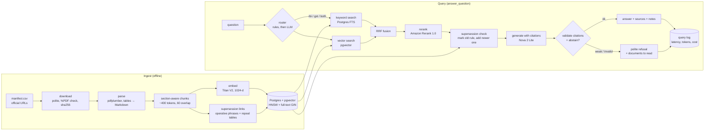

# Regulatory RAG (RBI + GST)

A retrieval-augmented question-answering system over **Indian banking regulation (RBI Master Directions)** and **GST circulars (CBIC)**. Every answer cites the document, section and page it came from. The system **warns when a rule has been superseded or amended**, **refuses to answer when the evidence is weak**, and is **measured** against a golden question set comparing four retrieval strategies.

```text
> uv run python -m regrag.query "Under the 2020 Priority Sector Lending Master Direction, what is the overall PSL target for a domestic commercial bank?"

The 2020 Priority Sector Lending Master Direction has been superseded. The current rule, as per the
2025 Master Directions, states that the overall PSL target for a domestic commercial bank is 40 per
cent of ANBC ... or CEOBE, whichever is higher [C2].

Sources:
  [C2] Master Directions - Reserve Bank of India (Priority Sector Lending – Targets and
       Classification) Directions, 2025 | Appendix, para 7.1 | p. 9
       https://www.rbi.org.in/Scripts/BS_ViewMasDirections.aspx?id=12799

Supersession notes:
  - RBI/FIDD/2020-21/72 was superseded by RBI/FIDD/2024-25/128; the current rule is in RBI/FIDD/2024-25/128.

route=rbi  config=hybrid_rerank  time=24.9s  cost=$0.00170
This is not legal or tax advice. Check the cited documents before acting.
```

**Corpus:** 65 official documents (25 RBI Master Directions, 40 CBIC GST circulars), 1,210 pages, 251 tables → 2,265 section-aware chunks. Source URLs and PDF fingerprints are in [`data/manifest.csv`](data/manifest.csv); the PDFs themselves are not committed.

## Architecture



Every stage sits behind a small interface (`Retriever`, `Reranker`, `Router`, `Generator`, `Validator`, `Embedder`) and the whole query path has one entry point, `answer_question()`. Later projects plug in there: a semantic cache in front, guardrails as extra validators, an agent that calls it as a tool.

## Evaluation results

61 golden questions (38 factual, 4 table, 5 cross-corpus, 7 superseded, 7 should-refuse; 33 with section-level gold) × 4 configurations. Generator Nova 2 Lite, faithfulness judge **Nova Pro**. 0 errors, run cost **$0.94**. The configurations differ **only** in retrieval and reranking. Full output: [`docs/eval/results.md`](docs/eval/results.md); analysis: [`docs/eval/tuning-notes.md`](docs/eval/tuning-notes.md).

| Configuration | Recall@5 | Recall@10 | MRR | Citation accuracy | Faithfulness | Abstention accuracy | p95 latency |
|---|---|---|---|---|---|---|---|
| keyword (Postgres FTS, BM25-like) | 0.74 | 0.81 | 0.62 | 0.93 | 0.97 | 0.70 | 3.6 s |
| vector (Titan V2 + pgvector) | 0.94 | 0.96 | 0.83 | 0.97 | 0.97 | 0.92 | 6.4 s |
| hybrid (keyword + vector, RRF) | 0.89 | 0.94 | 0.81 | 0.96 | 0.96 | 0.87 | 6.4 s |
| **hybrid + rerank (Amazon Rerank 1.0)** | **0.98** | **0.98** | **0.93** | **0.97** | 0.96 | 0.90 | 32.4 s |

Citation validity was 1.00 for every configuration (enforced by the validator). Every should-refuse question was refused in every configuration (abstention recall 1.00), and every superseded-rule answer carried a supersession note.

**Reading.** Reranking gives the best retrieval (MRR 0.93 vs 0.83 for vector alone). Hybrid search *without* a reranker was slightly worse than vector alone here: keyword search pulls in partly matching passages that the reranker then filters out. The remaining errors are mostly **wrong refusals** on cross-corpus questions. Latency for the reranked setup is almost all waiting for the account's 2-requests-per-minute rerank quota.

> **About the golden set:** the questions were drafted from real passages by the LLM, plus 8 written by hand. They were **reviewed by an LLM pass**, not a human: answers checked for support in the source passage, near-duplicates removed, 2 of 63 dropped. Each row is tagged `llm-reviewed` in [`data/golden/golden.jsonl`](data/golden/golden.jsonl). A human review pass is the next step.

Calibration of the abstain threshold (out-of-corpus questions scored about 100× lower than answerable ones): [Task 22 changelog](docs/changelogs/22-query-pipeline.md).

## Setup (Windows PowerShell)

Prerequisites: [uv](https://docs.astral.sh/uv/), Docker Desktop, Git, and an AWS account with Amazon Bedrock access.

```powershell
git clone https://github.com/GouthamTiwari/regulatory-rag.git
cd regulatory-rag
uv sync                                  # Python 3.12 + all dependencies into .venv
Copy-Item .env.example .env              # then edit .env (see below)
docker compose up -d                     # Postgres 17 + pgvector on 127.0.0.1:5433
uv run python -m regrag.db.init          # create tables and indexes
```

In `.env`: set **one** auth option. Recommended: a long-term **Amazon Bedrock API key** (`AWS_BEARER_TOKEN_BEDROCK`), which can only call Bedrock and expires on its own. Set `POSTGRES_PASSWORD` to any new local password. Defaults for regions and model IDs are in [`src/regrag/config.py`](src/regrag/config.py).

### Get the documents and build the index

```powershell
uv run python -m regrag.ingest.manifest --check          # 65 documents, all official hosts
uv run python -m regrag.ingest.download                  # GST PDFs download automatically
```

RBI's PDF server shows a **CAPTCHA** to automated clients. The downloader detects it and stops asking (it never tries to get around it). Save those PDFs in a browser, then import them:

```powershell
uv run python -m regrag.ingest.download --list-missing                  # what to save by hand
uv run python -m regrag.ingest.download --from-folder $HOME\Downloads   # import them
uv run python -m regrag.ingest.pipeline --skip-download --dry-run       # estimated cost (~$0.02)
uv run python -m regrag.ingest.pipeline --skip-download                 # parse, chunk, embed, store
```

## Usage

**Web page** (opens http://localhost:8501): ask a question, pick one of the four search setups, and see the answer with source cards, supersession warnings, time and cost.

**One click (Windows):** after setup, double-click `start.bat` in the project folder. It starts Docker Desktop and the database if needed, then opens the page. Close its window to stop. For a desktop icon: right-click `start.bat` → *Send to* → *Desktop (create shortcut)*.

```powershell
uv run streamlit run src/regrag/ui/app.py
```

**Command line:**

```powershell
uv run python -m regrag.query "Can a car dealer claim input tax credit on demo vehicles?"
uv run python -m regrag.query "..." --config hybrid       # bm25 | vector | hybrid | hybrid_rerank
uv run python -m regrag.query "..." --json                # full result: citations, usage, latency
uv run python -m regrag.eval --include-unreviewed --sample  # 4-way evaluation → docs/eval/
uv run pytest                                            # 350 unit tests, no AWS or Docker needed
```

## Design decisions

- **Amazon first-party models (Titan V2, Amazon Rerank 1.0, Nova 2 Lite, Nova Pro as final judge).** The account is billed in India (AISPL), where AWS Marketplace models (Claude, Cohere) can't be bought by card under the RBI payment-aggregator rule. Every model sits behind an interface, so Claude/Cohere are a one-line `.env` upgrade.
- **Mumbai for everything except reranking (Tokyo).** Mumbai is closest and has Titan and Nova via inference profiles, but no Indian region offers a Bedrock reranker. One long-term API key works in both regions.
- **Hybrid search + RRF.** Keyword search nails exact references ("231/25/2024-GST"); vector search finds paraphrases ("demo cars" ≈ "demonstration vehicles"). Reciprocal Rank Fusion (k = 60) merges them by rank, so the two scoring scales never need calibrating against each other.
- **Postgres for both searches.** One database, no extra service: pgvector (HNSW, cosine) for meaning, built-in full-text search (GIN) for keywords. The keyword leg is labelled honestly as *BM25-like*, not BM25.
- **Rerank via `InvokeModel`.** Bedrock API keys can't call the agent-runtime Rerank API, so the reranker uses `bedrock-runtime` with a small adapter per model.
- **Supersession, precision first.** Links between documents come from a hand-checked file, each with quoted evidence, plus text extraction that accepts only *operative* phrases ("stands withdrawn", "in supersession of"), never boilerplate ("as amended from time to time" appeared 134 times). Only reviewed links trigger warnings. When an outdated passage is retrieved, the system brings in the passage of the newer document that covers *the same rule* (vector similarity between passages), so the current rule is cited from the right document.
- **Abbreviations spelled out before search.** "What is RCM?" was refused: the bare abbreviation scored just under the abstain threshold and the router couldn't tell it was GST. A small glossary (only abbreviations that appear in the corpus with one meaning) turns it into "RCM (reverse charge mechanism)" for routing, search and generation; the answer still shows the question as typed.
- **Abstain instead of guess.** The answer must cite only supplied passages (checked in code), and the system refuses when the best rerank score is below a threshold **calibrated on real scores** (0.01), not guessed.
- **Built for a small AWS quota.** New-account quotas were 1% of the defaults (Titan 60 requests/min, Rerank 2/min). Bursts were throttled and botocore's adaptive retry mode froze. Calls are now **paced** below the quota, which gave zero throttling.
- **Section-aware chunking.** Chunks follow chapters, sub-headings and numbered paragraphs, never cross a chapter, keep tables whole (as Markdown, with captions), and carry the section number and pages used in citations.

## Cost

Embedding the whole corpus: **$0.016**. One answered question: **~$0.002–0.005** (Nova 2 Lite + one rerank). The full 4-way evaluation (61 questions × 4 configurations, Nova Pro judge): $0.94. Prices and the date they were checked: [`src/regrag/bedrock/pricing.py`](src/regrag/bedrock/pricing.py).

## Project layout

```text
src/regrag/
  config.py  types.py  interfaces.py
  bedrock/    client, retry, pricing, embedder, reranker, llm
  db/         schema.sql, connection, init, repository
  ingest/     manifest, download, parse, chunk, supersession, pipeline
  retrieval/  keyword, vector, fusion, hybrid
  query/      router, supersession, prompts, generate, validate, querylog, pipeline, CLI
  eval/       golden, metrics, judge, run
  ui/         Streamlit web page (app) + testable display helpers (view)
data/         manifest.csv, relations.csv, golden/golden.jsonl  (raw PDFs gitignored)
start.bat     one-click launcher for the web page (Windows)
docs/         SPEC.md, TASKS.md, CHANGELOG.md, changelogs/, eval/
```

The full specification is in [`docs/SPEC.md`](docs/SPEC.md), the task breakdown in [`docs/TASKS.md`](docs/TASKS.md), and a changelog per task (with what was verified and what went wrong) in [`docs/changelogs/`](docs/changelogs/).

## Known limitations

- Circulars only: no GST notifications, Acts or Rules; GST circulars numbered 251+ are not included.
- No OCR: 2 near-empty scanned pages are skipped.
- Extracted supersession links await human review; only the 7 hand-checked links drive warnings.
- Some section labels are imperfect (e.g. "Appendix, para 7.1" in the 2025 PSL directions).
- The web page is for local, single-user use (one question at a time; no login).

## Disclaimer

This project answers from public RBI and CBIC documents for learning and demonstration. It is **not legal or tax advice**. Always check the cited official document.
